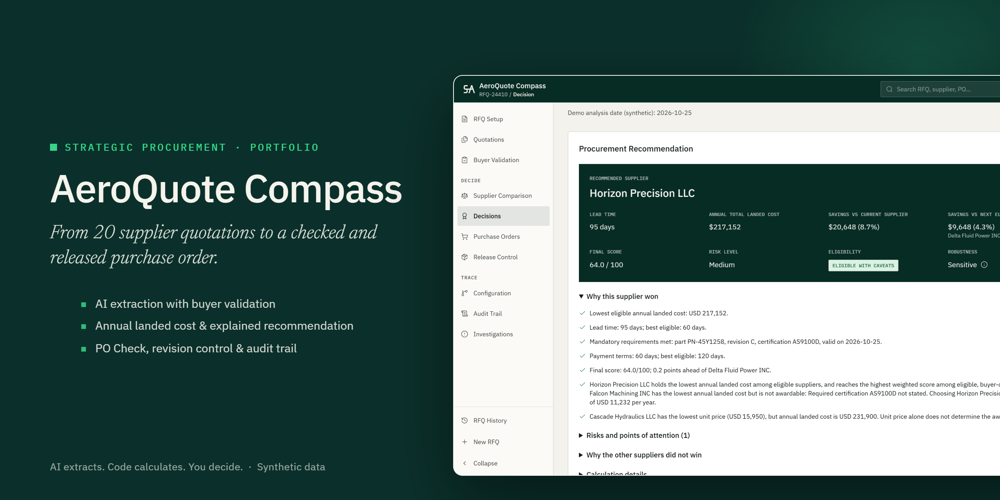

# Media

Demo media for AeroQuote Compass, grouped by recording date so each folder captures one stage of the app's evolution. Every supplier, price, part and person shown is synthetic.

## 2026-11-10: ERP navigation, PO Check and release

| File | What it shows | Format |
| --- | --- | --- |
| [`aeroquote-compass-demo.mp4`](2026-11-10/aeroquote-compass-demo.mp4) | Full walkthrough. It opens with the **results** (recommended supplier, released PO, auditable trail) and then shows the **process**: RFQ setup → buyer validation → comparison → decision → PO Check → release → revision control → audit trail. | MP4 · 1920×1080 · 30 fps · 3 min 50 s · no audio |
| [`aeroquote-compass-validation-to-recommendation.gif`](2026-11-10/aeroquote-compass-validation-to-recommendation.gif) | Buyer validation of 20 AI-extracted quotes (critical blockers, low confidence) through to the explained recommendation. | GIF · 960 px · ~27 s loop |
| [`aeroquote-compass-po-check-to-release.gif`](2026-11-10/aeroquote-compass-po-check-to-release.gif) | PO Check: a blocked PO, non-critical discrepancies accepted with written justification, then the correct PO released. | GIF · 960 px · ~19 s loop |
| [`aeroquote-compass-banner.png`](2026-11-10/aeroquote-compass-banner.png) | Project banner for the GitHub profile README and social previews. | PNG · 2560×1280 (1280×640 @2x) |

### Embed in a GitHub profile README

```markdown
[](https://aeroquote-compass.lovable.app)
```

Live demo: https://aeroquote-compass.lovable.app
